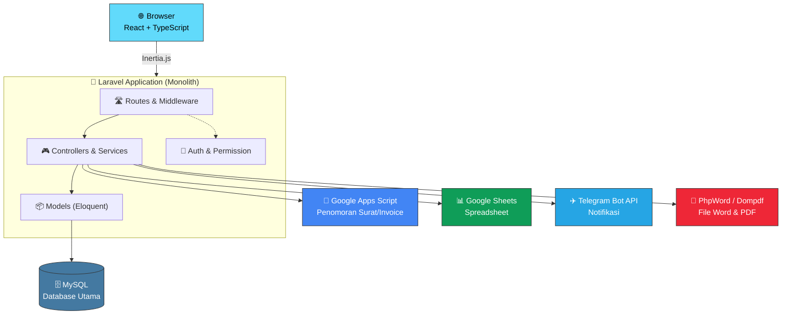
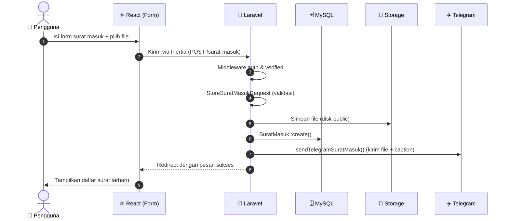
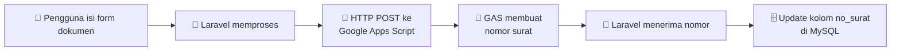
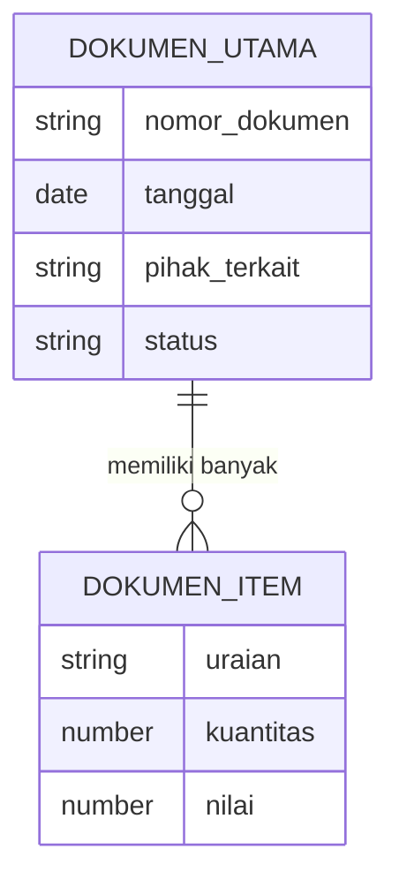
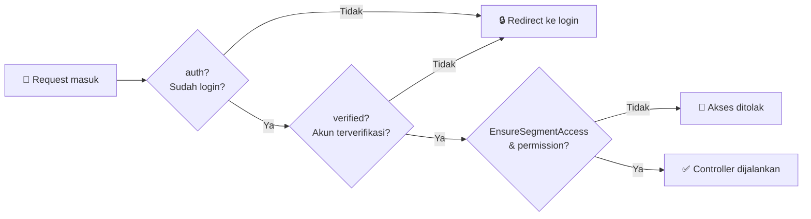

<div align="center">


<a href="https://git.io/typing-svg">
  
</a>

<br/>


**Satu aplikasi untuk mengelola surat, disposisi, invoice, dan puluhan dokumen administrasi, tanpa ribet.**

[🎯 Ringkasan](#-ringkasan-proyek) •
[✨ Fitur](#-fitur-utama) •
[🛠️ Tech Stack](#️-tech-stack) •
[🧩 Arsitektur](#-arsitektur-sistem) •
[🗃️ Database](#️-database) •
[🚀 Instalasi](#-instalasi-cepat) •
[🔐 Keamanan](#-catatan-keamanan-penting)

</div>

---

## 📑 Daftar Isi

<details open>
<summary><strong>Klik untuk buka / tutup</strong></summary>

1. [🎯 Ringkasan Proyek](#-ringkasan-proyek)
2. [🤔 Masalah yang Diselesaikan](#-masalah-yang-diselesaikan)
3. [✨ Fitur Utama](#-fitur-utama)
4. [🛠️ Tech Stack](#️-tech-stack)
5. [🧩 Arsitektur Sistem](#-arsitektur-sistem)
6. [🔄 Alur Kerja Aplikasi](#-alur-kerja-aplikasi)
7. [🗂️ Struktur Folder](#️-struktur-folder)
8. [🗃️ Database](#️-database)
9. [🔑 Autentikasi, Role, dan Permission](#-autentikasi-role-dan-permission)
10. [🔌 Integrasi Eksternal](#-integrasi-eksternal)
11. [📄 Pembuatan Dokumen](#-pembuatan-dokumen)
12. [🌐 Apakah Ada REST API?](#-apakah-ada-rest-api)
13. [🚀 Instalasi Cepat](#-instalasi-cepat)
14. [⚙️ Konfigurasi Environment](#️-konfigurasi-environment)
15. [🧪 Testing dan Kualitas Kode](#-testing-dan-kualitas-kode)
16. [🐳 Docker dan Deployment](#-docker-dan-deployment)
17. [🔐 Catatan Keamanan Penting](#-catatan-keamanan-penting)
18. [🧭 Roadmap dan Hal yang Perlu Diverifikasi](#-roadmap-dan-hal-yang-perlu-diverifikasi)
19. [📖 Kamus Istilah](#-kamus-istilah-untuk-pemula)
20. [👤 Developer](#-developer)

</details>

---

## 🎯 Ringkasan Proyek

**AMS Telkom** adalah aplikasi web **Enterprise Document Management System** yang dibuat untuk membantu pengelolaan dokumen dan proses administrasi di lingkungan **PT Telkom Indonesia**.

Bayangkan sebuah kantor digital. Surat masuk, disposisi atasan, dokumen pengadaan, sampai berita acara invoice, semuanya dicatat, dinomori, dan dilacak di satu tempat.

> [!NOTE]
> AMS Telkom dibangun sebagai **monolith**: satu aplikasi Laravel yang menangani semuanya (tampilan, logika, database, dan integrasi). Ini membuat proyek lebih mudah dipelajari, dijalankan, dan di-*deploy* dibanding arsitektur microservices.

### 📊 Sekilas Angka

| 📦 Model Eloquent | 🗄️ File Migration | 📑 Jenis Dokumen | 🔗 Integrasi Eksternal |
|:---:|:---:|:---:|:---:|
| **27** | **50+** | **10+** | **3** |

---

## 🤔 Masalah yang Diselesaikan

| 😵 Sebelum | 😎 Dengan AMS Telkom |
|---|---|
| Surat masuk dicatat manual di buku atau spreadsheet | Surat masuk tersimpan rapi di database, lengkap dengan file lampiran |
| Disposisi lewat kertas atau chat, sulit dilacak | Alur disposisi tercatat dan bisa ditelusuri |
| Nomor surat bentrok atau salah urut | Penomoran otomatis lewat Google Apps Script |
| Membuat SPH, SPK, BAKN, dll. dengan mengetik ulang | Isi form sekali, dokumen Word/PDF dihasilkan otomatis |
| Atasan telat tahu ada surat penting | Notifikasi langsung masuk ke Telegram |
| Semua orang bisa akses semua data | Hak akses dibatasi per role dan permission |

---

## ✨ Fitur Utama

### 📬 1. Surat Masuk dan Disposisi

- Catat surat masuk lengkap dengan **upload file**.
- Teruskan surat ke pihak terkait melalui **disposisi**.
- Setiap surat baru memicu **notifikasi Telegram** (beserta file dokumennya).
- Dikelola oleh `SuratMasukController` dan `DisposisiController`.

### 📝 2. Pembuatan Dokumen Administrasi

Setiap jenis dokumen punya controller, model, dan halaman sendiri:

| Kode | Dokumen | Kode | Dokumen |
|:---:|---|:---:|---|
| **SPH** | Surat Penawaran Harga | **SPK** | Surat Perintah Kerja |
| **SPPH** | Surat Permintaan Penawaran Harga | **SPPBJ** | Surat Penunjukan Penyedia Barang/Jasa |
| **BAKN** | Berita Acara Klarifikasi dan Negosiasi | **BASO** | Berita Acara Serah Terima / Operasi |
| **BS-BASO** | Berita Acara Turunan BASO | **SBM** | Dokumen SBM (beserta peserta) |
| **SSUK-SSKK** | Syarat-Syarat Umum / Khusus Kontrak | **P1, PL OPEX, BA Termin** | Dokumen pendukung lainnya |

> [!TIP]
> Kepanjangan beberapa singkatan di atas mengikuti istilah umum pengadaan. Sesuaikan dengan istilah resmi yang dipakai di unit kerja Anda.

### 🧾 3. Pengelolaan Invoice

- **Berita Acara Invoice** beserta **periode** dan **item** invoice.
- Penomoran invoice terhubung ke Google Apps Script (`GOOGLE_SCRIPT_INVOICE_URL`).

### 🔗 4. Alur dan Sinkronisasi Dokumen

- `DocumentFlowController` mengatur hubungan antar dokumen (dokumen mana mengarah ke dokumen mana).
- `LinkedDocumentSyncController` menjaga data dokumen yang saling terhubung tetap sinkron.

### 👥 5. Pengguna dan Hak Akses

- Login, registrasi, dan reset password (Laravel Fortify).
- Role dan permission yang fleksibel (Spatie Laravel Permission).
- Middleware khusus `EnsureSegmentAccess` untuk membatasi akses per segmen.

---

## 🛠️ Tech Stack

<div align="center">

| Lapisan | Teknologi | Fungsi dalam Bahasa Sederhana |
|---|---|---|
| ⚙️ **Backend** | Laravel 13.7+ | "Otak" aplikasi: menerima request, memproses, menyimpan data |
| 🐘 **Bahasa Backend** | PHP 8.3+ | Bahasa pemrograman di sisi server |
| 🎨 **Frontend** | React 19 | Membangun tampilan yang interaktif |
| 🔷 **Bahasa Frontend** | TypeScript | JavaScript dengan pengecekan tipe, mengurangi bug |
| 🌉 **Penghubung** | Inertia.js 3 | Jembatan Laravel dan React tanpa perlu membuat REST API |
| 💅 **Styling** | Tailwind CSS 4 | Mendesain tampilan dengan class utilitas |
| 🧩 **Komponen UI** | Radix UI, Headless UI, Lucide | Komponen siap pakai dan ikon |
| ⚡ **Build Tool** | Vite 8 | Dev server cepat dan proses build |
| 🗄️ **Database** | MySQL | Penyimpanan data utama |
| 🔗 **ORM** | Laravel Eloquent | Mengakses database lewat objek PHP, bukan SQL mentah |
| 🔐 **Autentikasi** | Laravel Fortify | Login, register, reset password |
| 🛡️ **Hak Akses** | Spatie Laravel Permission | Role dan permission |
| 📄 **Dokumen** | PhpWord, Dompdf | Menghasilkan file Word dan PDF |
| 🔌 **Integrasi** | Google Apps Script, Google Sheets, Telegram Bot API | Penomoran, spreadsheet, notifikasi |
| 🧪 **Testing** | Pest PHP | Pengujian otomatis backend |
| 🧹 **Kualitas Kode** | ESLint, Laravel Pint | Merapikan dan menjaga konsistensi kode |
| 🐳 **Deployment** | Docker Compose | Menjalankan aplikasi di lingkungan terisolasi |

</div>

---

## 🧩 Arsitektur Sistem

AMS Telkom memakai arsitektur **Monolith**. Frontend dan backend hidup dalam satu proyek, dihubungkan oleh Inertia.js.



### 💡 Apa Arti "Monolith"?

- Semua fitur (surat, invoice, disposisi, login, pembuatan dokumen) berjalan di **satu aplikasi Laravel**.
- Kode tetap rapi karena dipisah ke controller, model, service, dan middleware.
- Menghubungi Google Apps Script atau Telegram **tidak** membuat aplikasi ini menjadi microservices. Itu hanya aplikasi yang memanggil layanan luar.
- Docker Compose juga tidak otomatis berarti microservices. Itu hanya cara menjalankan aplikasi dengan rapi.

---

## 🔄 Alur Kerja Aplikasi

### Contoh: Membuat Surat Masuk Baru



**Penjelasan langkah demi langkah:**

| # | Tahap | Apa yang Terjadi |
|:-:|---|---|
| 1 | **Route** | `Route::post('/surat-masuk', [SuratMasukController::class, 'store'])` menerima request |
| 2 | **Middleware** | `auth` dan `verified` memastikan pengguna sudah login dan terverifikasi |
| 3 | **Form Request** | `StoreSuratMasukRequest` memeriksa kelengkapan dan format input |
| 4 | **Controller** | `SuratMasukController::store()` mengatur seluruh proses |
| 5 | **Storage** | File lampiran disimpan ke disk `public` |
| 6 | **Model** | `SuratMasuk::create($data)` menyimpan data ke MySQL |
| 7 | **Notifikasi** | Telegram menerima pesan dan dokumen |
| 8 | **Respons** | Pengguna diarahkan kembali dengan pesan sukses |

### Contoh: Penomoran Surat via Google Apps Script



### Contoh: Membuat Dokumen SPH

1. Pengguna mengisi form (`SphController::store`).
2. Input divalidasi (`StoreSphRequest`).
3. Data utama disimpan (`Sph::create`).
4. Item-itemnya disimpan (`SphItem::create`, beberapa baris).
5. Dokumen dibuat dengan PhpWord.
6. Pengguna mengunduh atau melihat hasilnya.

---

## 🗂️ Struktur Folder

<details>
<summary><strong>📂 Klik untuk melihat struktur folder lengkap</strong></summary>

```
ams-telkom/
│
├── app/
│   ├── Http/
│   │   ├── Controllers/              # Pengatur alur request
│   │   │   ├── Surat/SuratMasukController.php
│   │   │   ├── Disposisi/DisposisiController.php
│   │   │   ├── BeritaAcara/          # SPH, SPK, BAKN, dll.
│   │   │   ├── User/UserController.php
│   │   │   └── ...
│   │   ├── Requests/                 # Validasi input (StoreXxxRequest)
│   │   └── Middleware/               # Pemeriksaan request (mis. EnsureSegmentAccess)
│   ├── Models/                       # 27 model Eloquent
│   │   ├── User.php
│   │   ├── SuratMasuk.php
│   │   ├── Disposisi.php
│   │   ├── BeritaAcaraInvoice.php
│   │   ├── Sph.php · SphItem.php
│   │   ├── Spk.php · SpkItem.php
│   │   └── ...
│   └── Services/                     # Logika bisnis terpisah
│       └── GoogleSpreadsheetLetterService.php
│
├── database/
│   ├── migrations/                   # 50+ file struktur tabel
│   ├── factories/                    # Data palsu untuk testing
│   └── seeders/                      # Data awal
│
├── resources/
│   └── js/
│       └── Pages/                    # Halaman React
│           ├── surat-masuk/
│           ├── disposisi/
│           ├── berita-acara-invoice/
│           └── ...
│
├── routes/
│   ├── web.php                       # Route utama (Inertia)
│   └── auth.php                      # Route autentikasi
│
├── docker-compose.yml                # Orkestrasi container
├── DockerFile                        # Resep image aplikasi
├── composer.json                     # Dependensi PHP
├── package.json                      # Dependensi JavaScript
└── .env.example                      # Contoh konfigurasi
```

</details>

### 🧠 Siapa Mengerjakan Apa?

| Bagian | Tanggung Jawab | Analogi Restoran 🍽️ |
|---|---|---|
| **Route** | Menentukan URL mengarah ke mana | Daftar menu dan nomor meja |
| **Middleware** | Memeriksa siapa yang boleh masuk | Satpam di pintu |
| **Form Request** | Validasi input | Pelayan mengecek pesanan |
| **Controller** | Mengatur alur kerja | Kepala pelayan |
| **Service** | Logika kompleks / layanan luar | Koki spesialis |
| **Model** | Berbicara dengan database | Gudang bahan makanan |
| **React Page** | Tampilan untuk pengguna | Meja makan dan sajian |

---

## 🗃️ Database

AMS Telkom menggunakan **MySQL** (bukan SQLite) dengan **Eloquent ORM** dan **migration** untuk mengelola struktur tabel.

### 🧱 Pola Utama dan Item

Hampir semua dokumen memakai pola yang sama: satu **dokumen utama** dan banyak **item** di dalamnya.



> [!NOTE]
> Diagram di atas adalah **gambaran konseptual** pola yang berulang pada SPH/SphItem, SPK/SpkItem, dan seterusnya. Detail kolom dan relasi sebenarnya ada di folder `database/migrations/`.

### 📚 Daftar Model (27 Model)

| Kelompok | Model |
|---|---|
| 👤 **Pengguna** | `User`, `Role`, `Permission` |
| 📬 **Surat & Disposisi** | `SuratMasuk`, `Disposisi`, `TujuanDisposis` |
| 🧾 **Invoice** | `BeritaAcaraInvoice`, `InvoicePeriode`, `InvoiceItem` |
| 💰 **SPH** | `Sph`, `SphItem` |
| 🛠️ **SPK** | `Spk`, `SpkItem` |
| 🤝 **BAKN** | `Bakn`, `BaknItem` |
| 📨 **SPPH** | `Spph`, `SpphItem` |
| ✅ **SPPBJ** | `Sppbj`, `SppbjItem` |
| 📋 **BASO** | `BeritaAcaraBaso`, `BeritaAcaraBasoItem`, `Baso`, `BasoItem` |
| 👥 **SBM** | `Sbm`, `SbmParticipant` |
| 📑 **SSUK-SSKK** | `SsukSskk`, `SsukSskkItem`, `SsukSskkSlg` |
| 📦 **Lainnya** | `P1`, `P1Item`, `PlOpex`, `BaTermin`, `BaTerminItem` |

### 🕰️ Migration Penting

| File | Isi |
|---|---|
| `2025_04_24_003526_create_surat_masuks_table.php` | Tabel surat masuk |
| `2026_06_09_160517_create_berita_acara_invoices_table.php` | Tabel berita acara invoice |
| `2026_06_15_115254_create_permission_tables.php` | Tabel role dan permission (Spatie) |
| `2026_07_09_102539_create_ssuk_sskks_table.php` | Tabel SSUK-SSKK |

---

## 🔑 Autentikasi, Role, dan Permission

Dua pertanyaan berbeda, dua alat berbeda:

| Pertanyaan | Istilah | Alat |
|---|---|---|
| ❓ *"Kamu siapa?"* | **Autentikasi** | Laravel Fortify |
| ❓ *"Kamu boleh melakukan apa?"* | **Otorisasi** | Spatie Laravel Permission |



> [!IMPORTANT]
> Pemeriksaan hak akses harus dilakukan **di backend**, bukan hanya dengan menyembunyikan tombol di frontend.

---

## 🔌 Integrasi Eksternal

AMS Telkom **mengonsumsi** layanan luar. Aplikasi ini memanggil layanan tersebut, bukan sebaliknya.

### 📜 Google Apps Script dan Google Sheets

| Item | Keterangan |
|---|---|
| **Service** | `GoogleSpreadsheetLetterService` (`app/Services/`) |
| **Fungsi** | Penomoran surat dan integrasi spreadsheet |
| **Config** | `GOOGLE_SCRIPT_LETTER_URL`, `GOOGLE_SCRIPT_INVOICE_URL` |

### ✈️ Telegram Bot API

| Endpoint | Fungsi |
|---|---|
| `sendMessage` | Mengirim pesan teks |
| `sendDocument` | Mengirim file dokumen beserta caption |

Contoh pola kode pada `SuratMasukController`:

```php
protected function sendTelegramSuratMasuk($surat)
{
    $botToken = env('TELEGRAM_BOT_TOKEN');

    // Kirim file surat ke setiap penerima lewat sendDocument
    Http::attach('document', file_get_contents($filePath), $fileName)
        ->post("https://api.telegram.org/bot{$botToken}/sendDocument", [
            'chat_id'    => $chatId,
            'caption'    => $caption,
            'parse_mode' => 'HTML',
        ]);
}
```

> [!WARNING]
> Pada implementasi saat ini, daftar `chat_id` penerima masih **ditulis langsung di dalam kode controller**, dan request memakai `Http::withoutVerifying()` (verifikasi sertifikat SSL dimatikan). Lihat bagian [Catatan Keamanan](#-catatan-keamanan-penting) untuk saran perbaikan.

---

## 📄 Pembuatan Dokumen

| Teknologi | Peran |
|---|---|
| **PhpWord** | Membuat dan mengubah dokumen Word (`.docx`) |
| **Dompdf** | Mengubah HTML menjadi PDF |
| **Google Apps Script** | Penomoran dan integrasi spreadsheet |
| **Google Sheets** | Dukungan data spreadsheet |

---

## 🌐 Apakah Ada REST API?

**Belum ditemukan bukti** adanya REST API terpisah untuk pihak ketiga.

| Temuan | Status |
|---|---|
| `routes/web.php` (route utama, Inertia) | ✅ Ada |
| `routes/auth.php` (route autentikasi) | ✅ Ada |
| `routes/api.php` | ❌ Tidak ditemukan |

**Kesimpulan:** data dikirim ke React lewat `Inertia::render('halaman', $data)`, jadi tidak perlu endpoint REST. Jika nanti dibutuhkan, API bisa ditambahkan lewat `routes/api.php`.

---

## 🚀 Instalasi Cepat

### Prasyarat

- 🐘 PHP **8.3+** dan Composer
- 🟢 Node.js dan npm (untuk Vite)
- 🗄️ MySQL
- 🐳 Docker dan Docker Compose *(opsional)*

### Langkah 1: Ambil Kode

```bash
git clone <URL-REPOSITORY-ANDA>
cd ams-telkom
```

### Langkah 2: Pasang Dependensi

```bash
composer install
npm install
```

### Langkah 3: Siapkan Environment

```bash
cp .env.example .env
php artisan key:generate
```

Lalu isi nilai `.env` sesuai komputer Anda (lihat [Konfigurasi Environment](#️-konfigurasi-environment)).

### Langkah 4: Siapkan Database

Buat database kosong bernama `ams` di MySQL, lalu jalankan:

```bash
php artisan migrate
```

### Langkah 5: Jalankan Aplikasi

**Mode development** (satu perintah untuk semuanya):

```bash
composer run dev
```

Perintah ini menjalankan sekaligus `php artisan serve`, `php artisan queue:listen`, dan `npm run dev`.

**Mode produksi** (build aset terlebih dahulu):

```bash
npm run build
```

Buka **http://127.0.0.1:8000** di browser.

---

## ⚙️ Konfigurasi Environment

Salin `.env.example` menjadi `.env`, lalu isi:

```dotenv
APP_NAME=AMS
APP_ENV=local

# Database MySQL
DB_CONNECTION=mysql
DB_HOST=127.0.0.1
DB_PORT=3306
DB_DATABASE=ams
DB_USERNAME=root
DB_PASSWORD=ISI_PASSWORD_DATABASE_ANDA

# Telegram Bot
TELEGRAM_BOT_TOKEN=ISI_TOKEN_BOT_ANDA

# Google Apps Script
GOOGLE_SCRIPT_LETTER_URL=ISI_URL_SCRIPT_SURAT
GOOGLE_SCRIPT_INVOICE_URL=ISI_URL_SCRIPT_INVOICE
```

| Variable | Fungsi |
|---|---|
| `DB_*` | Koneksi ke MySQL |
| `TELEGRAM_BOT_TOKEN` | Token bot dari @BotFather |
| `GOOGLE_SCRIPT_LETTER_URL` | URL Apps Script untuk penomoran surat |
| `GOOGLE_SCRIPT_INVOICE_URL` | URL Apps Script untuk penomoran invoice |

> [!CAUTION]
> **Jangan pernah** menulis password asli atau token asli di `.env.example`, README, atau repository. File `.env.example` hanya boleh berisi **contoh/placeholder**.

---

## 🧪 Testing dan Kualitas Kode

| Perintah | Fungsi |
|---|---|
| `php artisan test` | Menjalankan test backend (Pest PHP) |
| `npm run lint` | Merapikan kode frontend dengan ESLint (auto-fix) |
| `npm run lint:check` | Mengecek kode frontend tanpa mengubah |
| `npm run types:check` | Mengecek tipe TypeScript (`tsc --noEmit`) |
| `./vendor/bin/pint` | Merapikan format kode PHP (Laravel Pint) |

---

## 🐳 Docker dan Deployment

File yang tersedia: `docker-compose.yml`, `DockerFile`, dan `.dockerignore`.

Docker Compose mendefinisikan layanan-layanan (aplikasi, web server, database) dalam satu lingkungan yang konsisten, jadi "jalan di laptop saya" juga berarti jalan di server.

### ✅ Checklist Sebelum Produksi

- [ ] `APP_ENV=production` dan `APP_DEBUG=false`
- [ ] Password database kuat dan unik
- [ ] Token Telegram baru, tidak pernah masuk repository
- [ ] HTTPS (SSL/TLS) aktif
- [ ] `npm run build` sudah dijalankan
- [ ] Backup database terjadwal
- [ ] Log aplikasi dipantau dan tidak bisa diakses publik

---

## 🔐 Catatan Keamanan Penting

> [!WARNING]
> Bagian ini berisi hal-hal yang **sebaiknya segera diperbaiki** sebelum aplikasi dipakai luas.

| 🚨 Temuan | 💡 Saran |
|---|---|
| Kredensial (password DB, token bot) pernah tertulis di contoh konfigurasi | Anggap sudah bocor: **ganti password DB** dan **buat token baru** lewat @BotFather (`/revoke`). Pakai placeholder di `.env.example` |
| `chat_id` Telegram ditulis langsung di controller | Pindahkan ke `config/` atau `.env`, atau simpan di database |
| `Http::withoutVerifying()` mematikan verifikasi SSL | Hapus; pastikan sertifikat CA server benar agar koneksi ke Telegram tetap aman |
| `env()` dipanggil langsung di controller | Gunakan `config('services.telegram.token')`, supaya tetap jalan saat `config:cache` |
| Pemeriksaan permission | Pastikan tiap aksi penting dicek di backend (policy / middleware / `can`) |

---

## 🧭 Roadmap dan Hal yang Perlu Diverifikasi

README ini disusun dari analisis kode. Beberapa hal sebaiknya dicek langsung di source code sebelum dianggap final:

| Area | Yang Perlu Diperiksa |
|---|---|
| 🏗️ Arsitektur | Pembagian tanggung jawab controller, service, model |
| 🌐 API | Ada atau tidaknya `routes/api.php` |
| 📜 Google Apps Script | Validasi respons, timeout, dan penanganan nomor ganda |
| ✈️ Telegram | Penanganan error dan keamanan token |
| 🗄️ Database | Foreign key, indeks, dan constraint |
| 🛡️ Hak Akses | Pemeriksaan permission di setiap aksi |
| 📄 Dokumen | Validasi template dan penyimpanan file |
| 🧪 Testing | Cakupan test dan hasil pengujian |
| 🚢 Deployment | Environment, backup, dan log |

### 🌱 Ide Pengembangan

- [ ] Pindahkan penerima Telegram ke pengaturan (bukan hard-code)
- [ ] Tambahkan `routes/api.php` bila perlu integrasi pihak ketiga
- [ ] Antrian (queue) untuk pengiriman Telegram dan pembuatan dokumen berat
- [ ] Riwayat perubahan (audit log) pada dokumen
- [ ] Dashboard ringkasan surat dan invoice

---

## 📖 Kamus Istilah untuk Pemula

| Istilah | Arti Sederhana |
|---|---|
| **Monolith** | Satu aplikasi besar yang berisi semua fitur |
| **Controller** | Kode yang menerima permintaan lalu memutuskan apa yang dilakukan |
| **Model / Eloquent** | Objek PHP yang mewakili satu tabel database |
| **Migration** | "Catatan resep" untuk membuat atau mengubah tabel database |
| **Middleware** | Penjaga yang memeriksa request sebelum masuk ke controller |
| **Inertia.js** | Jembatan agar Laravel bisa menampilkan halaman React tanpa REST API |
| **Role** | Peran pengguna (mis. admin, staf) |
| **Permission** | Izin spesifik (mis. boleh menghapus surat) |
| **Disposisi** | Perintah/arahan atasan untuk meneruskan surat ke pihak lain |
| **Docker Compose** | Alat untuk menjalankan beberapa container sekaligus |
| **Webhook / Bot API** | Cara aplikasi berkirim pesan ke layanan seperti Telegram lewat internet |

---

## 👤 Developer

| Nama | Peran | Kontak |
|---|---|---|
| **NAMA ANDA** | Developer | [GitHub](https://github.com/USERNAME-ANDA) |

---

<div align="center">


**AMS Telkom** &nbsp;·&nbsp; Enterprise Document Management System

*Dibuat dengan ☕, Laravel, dan React*

</div>
